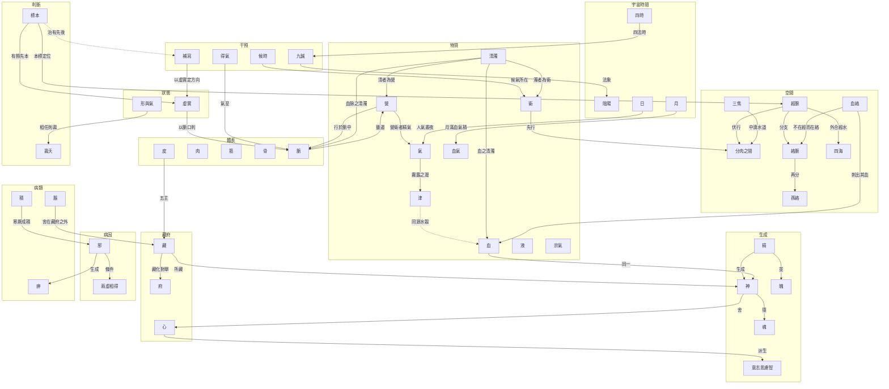

# 64 概念地圖

續 `docs/63`。矛盾核完，現在把概念連起來。
**資料**：`data/概念地圖.json`（46 節點、42 連線、8 條矛盾）。圖由 `scripts/make_concept_map.py` 從資料自動產生。

---

## 一、怎麼讀

- **節點**＝一個概念，依「層」分組（宇宙時間、生成、物質、空間、體表、藏府、狀態、病因、病類、干預、判斷）。
- **實線箭頭**＝原文明確說過的關係，箭頭上的字是原文用的動詞。
- **虛線箭頭**＝我的歸納，不是原文。
- **矛盾**不畫成箭頭，另列於第五節。

---

## 二、分層

| 層 | 節點 |
|---|---|
| 宇宙時間 | 陰陽、四時、月、日 |
| 生成 | 精、神、魂、魄、意志思慮智 |
| 物質 | 氣、血、津、液、營、衛、宗氣、血氣 |
| 空間 | 分肉之間、經脈、絡脈、孫絡、三焦、四海 |
| 體表 | 皮、肉、筋、骨、脈 |
| 藏府 | 心、藏、府 |
| 狀態 | 虛實、形與氣 |
| 病因 | 邪、兩虛相得 |
| 病類 | 脹、痹、積 |
| 干預 | 補寫、得氣、候時、九鍼 |
| 判斷 | 壽夭 |

---

## 三、連線的六種類型

42 條連線。下表先把原有的 33 條按關係動詞分類；本輪新增的 9 條另列於後。

| 類型 | 例 | 條數 |
|---|---|---:|
| **生成** | 兩精相搏謂之神；得寒乃生，厥乃成積 | 5 |
| **居所** | 神氣舍心；經脈伏行分肉之間 | 6 |
| **同一** | 血者，神氣也；營衛者，精氣也 | 2 |
| **邊界／分支** | 經脉為裏，支而横者為絡；絡之別者為孫 | 2 |
| **條件** | 兩虚相得，乃客其形 | 1 |
| **操作** | 寫者迎之；氣至乃去；逢時 | 5 |

（其餘為法象、對舉、所藏等，詳見 JSON。）

本輪新增 9 條，其中 8 條是原文、1 條是歸納：

| 新增連線 | 類型 | 依據 |
|---|---|---|
| 清濁→營／衛 | 同一 | 營衛生會：其清者為營，濁者為衛 |
| 清濁→血／脈 | **屬性**（新型） | 逆順肥瘦：血之清濁；決氣：血脉之清濁 |
| 血絡→絡脈 | 邊界 | 血絡論：奇邪而不在經者，血絡是也 |
| 血絡→血 | 操作 | 經脉：凡刺寒熱者皆多血絡……血盡而止 |
| 標本→經脈 | **定位**（新型） | 衛氣：足太陽之本……標在兩絡命門 |
| 標本→虛實 | 條件 | 病本：病發而有餘，本而標之 |
| 標本→補寫（虛線） | 操作 | 病本、師傳、衛氣三套並參——我的歸納 |

**「同一」只有兩條，但份量最重。** 「血者，神氣也」不是比喻，是等式；「營衛者，精氣也」也是。這種寫法在靈樞裡很少見，值得單獨記住。

---

## 四、四個結構發現

### （1）度數最高的節點，是最沒有定義的

算出每個節點的連線數：

| 節點 | 度數 |
|---|---:|
| **神** | **5** |
| **脈** | **5** |
| 血、營、經脈、藏、清濁 | 4 |
| 氣、衛、分肉之間、絡脈、虛實 | 3 |

（加入清濁、血絡、標本後重算。清濁一進來就有 4 度，直接並列第二梯隊。）

**神是整張圖的中心，卻是全書最不肯被定義的字**（`docs/57`：八個等式，沒有總定義）。

**我的理解是**：一個概念在系統裡越核心，越難被定義——因為它要同時服務太多語境。定義會限制它。

### （2）「分肉之間」是唯一的三重樞紐

它同時連接三條線：

- 經脈**伏行**於此
- 衛氣**先行**於此
- 三焦是**中瀆**（水道），與此相通
- 而痹的生成也從這裡開始（周痹「獨居分肉之間」）

**我的理解是**：靈樞裡真正的中樞不是某個臟腑，是**一個空間**。這與 `docs/47`『經脈是間』的結論一致。

### （3）操作層沒有入邊

圖上有兩個節點沒有任何箭頭指向它們：**得氣**、**候時**。

**補寫**本來也是其中之一。本輪加了一條從標本指向補寫的虛線（我的歸納），它才第一次有了入邊——但那是**歸納**，不是原文，而且它講的是『先治哪個』，不是『怎麼刺』。所以原來的觀察仍然成立：原文沒有從理論層演繹出操作層。

**我的理解是**：這說明靈樞的操作規定，**不是從理論層演繹出來的**。它不從『氣是什麼』推出『怎麼補瀉』，而是直接規定『迎著氣來是瀉』。

### （4）三個新節點，暴露了這張圖的來歷

本輪補上清濁、血絡、標本。它們不是普通的三個詞：

| 節點 | 為什麼非要補 |
|---|---|
| 清濁 | 全書 102 字次，比「神」「精」都多，卻不在圖上 |
| 血絡 | 全書唯一有定義式的脈管名詞（`docs/78`） |
| 標本 | 貫穿三篇的決策軸（`docs/79`） |

〔歸〕漏掉它們的原因不是疏忽，是**建圖的方法**：這張圖是從「講道理」的篇（本神、決氣、經脈、本藏……）建起來的，而這三個概念住在「講操作」的篇（陰陽清濁、血絡論、病本、衛氣）。

**後果比漏三個點嚴重**：不在圖上，就不會進矛盾盤點。所以上一版才會寫出『概念層沒有未解的矛盾』這種話——不是查過，是沒節點可查。

（本節保留原句不刪，見第五節的更正。）

這也解釋了為什麼補寫沒有正式定義（`docs/61`）——它不需要定義，它是**起點**。

---

## 五、八條矛盾在圖上的位置

| 爭點 | 位置 | 狀態 |
|---|---|---|
| 毫鍼長度 | 干預層·九鍼 | **未解** |
| 肝所配（筋／爪） | 體表×藏府 | 可調和 |
| 腎所配（腠理毫毛／骨） | 體表×藏府 | 可調和 |
| 留針 | 干預層·補寫 | 可調和 |
| 虛實性質 | 狀態層 | 存疑 |
| 輸刺三義 | 干預層·九鍼 | 同名異實 |
| **清濁與刺法** | 物質層·清濁（新增） | **未解** |
| **十二經根與本** | 空間層·經脈（新增） | **未解** |

**分佈特徵**：四條在「配屬」與「劑量」，兩條在『操作定義』，兩條在『推論與取法』。

**上一版寫過一句『概念層（生成、物質、空間）沒有未解的矛盾』，現在不成立了。** 補上清濁與標本之後，物質層多了一條（清濁與刺法推不通），空間層也多了一條（根結與衛氣取法不同）。原因是先前那三個節點根本不在圖上——**不在圖上，就不會出現在矛盾的盤點裡。** 這是圖的另一種盲點：它會讓你以為自己已經看全了。

---

## 六、這張圖的選擇與代價

1. **我把陰陽放在『宇宙時間』層，且只讓它被指向、不讓它指向別人。** 這是我的選擇——原文的陰陽是背景語法，放進圖裡會變成無所不在的節點，圖就畫不出結構了。
2. **「心」只出現在藏府層，但它在生成層（任物）也該有位置。** 為了避免一節點多層，我把它歸在藏府。
3. **42 條連線是選的，不是窮盡的。** 靈樞的概念關係遠多於此，我選了『原文明確用動詞說過』的那些。
4. **虛線只有兩條**（津→血同源水穀；標本→補寫治有先後），因為其餘歸納我都寫在文件裡，沒進圖。

---

## 七、限制

1. **圖是二維的，原文是多層的。** 有些關係（如神同時是正氣、是水穀精氣、是生命）在圖上只能畫成一條線，會失真。
2. **「層」的分法是自擬的**，原文沒有這些層名。
3. **連線方向有主觀成分。** 「精→神」是原文的生成序；但「邪→痹」也可以畫成雙向。
4. **未納入時間維度。** 四時、日、月雖在圖上，但『什麼時候做什麼』的關係只在 `docs/58` 處理，圖上只留了兩個箭頭。
5. **未與注家比對。** 太素、類經對這些關係多有補充。

---

*資料：`data/概念地圖.json`*
*前篇：`docs/63`（矛盾）、`docs/49`（概念）、`docs/47`（經脈）*
