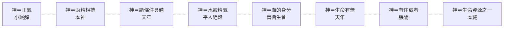
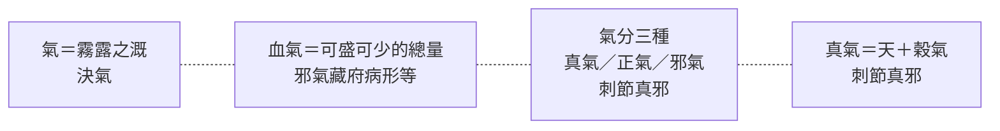
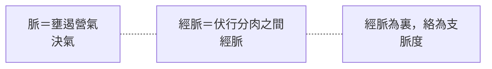

# 65 多層概念的圖示法

續 `docs/64`。使用者問：原文的「多層」能不能用圖直觀表達？
> 答案是可以，但要換一種畫法——**同一個字，拆成多層節點**，而不是壓成一個節點。

---

## 一、為什麼單節點畫不出來

概念地圖（`docs/64`）裡，神只有一個節點，連了五條線。

但實際情況是：神在針刺語境是「正氣」，在生成語境是『兩精相搏之產物』，在養生語境是「水穀精氣」……**這些不是同一個節點的多條邊，是同一個字的多個用法。**

壓成一個節點，圖會失真：看起來像『神有八個面向』，其實是**八個不能互相代入的等式**。

---

## 二、換一種畫法：同名多層

規則很簡單：

- **縱向**：同一個字，用虛線串起來，表示『這是同一個詞』。
- **橫向**：每一層是一個語境，寫它自己的等式與出處。
- **不畫箭頭**：層與層之間沒有推導關係，只有同名關係。

### 神的八層

### 氣的層

### 脈的層

---

## 三、也做了一張圖檔

同樣的內容另做成資訊圖，可直接看：

- 圖檔：`export/多層概念圖.png`（1400×1382）
- 原始檔：`export/多層概念圖.html`（可自行改字、改色、改尺寸後重拍）

圖的設計：

| 位置 | 內容 |
|---|---|
| 左欄 | 語境（針刺／生成／整合／養生／身分／生死／空間／資源） |
| 中欄 | 同一個字，縱向以虛線串起 |
| 右欄 | 該層的原文等式 |
| 最右 | 出處篇名 |

三組並排：神（8 層）、氣（4 層）、脈（3 層），用來說明這套畫法可以推廣。

**我沒能親眼確認這張圖的排版。** 產生圖檔時，視覺服務回報額度不足（HTTP 429），所以無法檢查文字有沒有重疊或截斷。
圖是固定版式渲染的（1400px 寬、四欄），數字上不該溢出，但**『應該沒問題』不等於「我看過」**。請你打開看一眼；若有問題，改 HTML 重拍即可。

---

## 四、這套畫法的用處與限制

### 用處

1. **一眼看出『同名不同實』。** 神的八層排開，『不能互相代入』就變成視覺事實，而不是一句提醒。
2. **避免把分層誤讀成矛盾。** 排成多層之後，就不會問『神到底是正氣還是水穀精氣』——問題本身消失了。
3. **可以推廣到任何多義詞**：氣、脈、血、虛實、形，都能這樣拆。

### 限制

1. **它不表達關係。** 哪一層影響哪一層、哪一層是基礎，這張圖看不出來（那是概念地圖的工作）。
2. **層的數目是我選的。** 神有八層，但也可以拆成六層或十層，取決於切分粗細。
3. **「層」這個詞本身是比喻。** 原文沒有說神分八層；這是為了視覺化而做的組織。
4. **虛線的意義要說清楚。** 它只表示『同一個字』，不表示『同一件事』。這一點若誤讀，整張圖就白畫了。

---

## 五、如果要繼續

可以為其他多義詞各做一張：

| 概念 | 層數 | 狀態 |
|---|---:|---|
| 神 | 8 | 已做 |
| 氣 | 4 | 已做 |
| 脈 | 3 | 已做 |
| 血 | 3 | 可做（生成／身分／與汗的存量關係） |
| 虛實 | ? | 可做（有無／多少／脈口） |
| 形 | ? | 可做（形充／形脫／形氣相任） |

---

*資料：`data/概念地圖.json`、`export/多層概念圖.html`、`export/多層概念圖.png`*
*前篇：`docs/57`（神）、`docs/64`（概念地圖）*
