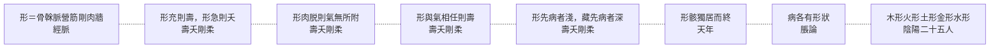

# 68 形：八層

系列第五張（神 8、氣 4、脈 3、血 7、虛實 7）。方法見 `docs/65`。
**引號規矩同前**：「」只給《靈樞》原文，經機器驗證；『』給其他典籍與我自撰的詞。

---

## 一、八層

| 語境 | 原文 | 出處 |
|---|---|---|
| **生成** | 骨爲榦，脉爲營，筋爲剛，肉爲牆，皮膚堅而毛髮長 | 經脈 |
| **充實** | 形充而皮膚緩者則壽；形充而皮膚急者則夭 | 壽夭剛柔 |
| **消脫** | 病而形肉脱，氣勝形者死，形勝氣者危矣 | 壽夭剛柔 |
| **比值** | 形與氣相任則壽，不相任則夭；血氣經絡勝形則壽，不勝形則夭 | 壽夭剛柔 |
| **病程** | 形先病而未入藏者，刺之半其日；藏先病而形乃應者，刺之倍其日 | 壽夭剛柔 |
| **遺形** | 百歲，五藏皆虚，神氣皆去，形骸獨居而終矣 | 天年 |
| **病形** | 五藏六府者各有畔界，其病各有形狀 | 脹論 |
| **分類** | 木形之人，比於上角，似於蒼帝…… | 陰陽二十五人 |

圖檔：`export/多層_形.png`（1400×1100）；HTML：`export/多層_形.html`。



---

## 二、形的特殊之處：它有出生，也有殘留

其他概念的層次都在「活著」的範圍內打轉——氣、血、脈、虛實，都是生理或病理的狀態。

形不一樣。它從**生成**（骨爲榦，脉爲營）一路用到**遺形**（形骸獨居而終）。

這是全書少見的一條完整時間軸：

```
生成 → 充實／消脫 → 相任／相勝 → 病程先後 → 死後遺形
```

**我的理解是**：形的這一條線，其實是靈樞對「身體」最完整的一次交代——它不只講身體怎麼運作，也講身體怎麼形成、怎麼衰敗、怎麼留下。

---

## 三、三個要點

### （1）「形充」是判斷的前提

〈壽夭剛柔〉連著五句，每句都從同樣四個字開始：

> **形充而**皮膚緩者則壽，形充而皮膚急者則夭。

> **形充而**脉堅大者順也，形充而脉小以弱者氣衰，衰則危矣。

> **形充而**顴不起者骨小，骨小而夭矣。

**先要形夠，才談細節。** 形不足，皮膚鬆緊、脈之堅弱都失去意義。

（詳見 `docs/55`。）

### （2）同一個「形勝氣」，健康與病中相反

> 平人而氣勝形者壽；病而形肉脱，氣勝形者死，形勝氣者危矣。

關鍵在「形肉脱」。形完好時，氣勝形是精力充沛；形已消脫時，氣勝形是**氣無所附**。

**我的理解是**：形不只是『有多少肉』，它是**氣所依附的東西**。形沒了，氣再強也不是好事。

### （3）「形狀」是另一個意思

第七層容易被忽略：

> 五藏六府者各有畔界，**其病各有形狀**。

這裡的「形狀」不是體型，是**病的形態**——脹在哪裡、什麼樣子。

**我的理解是**：同一個字，從『身體的形』滑到「病的形」，靠的是「畔界」這個概念：因為藏府各有邊界，所以病各有位置；因為有位置，所以有形狀。

---

## 四、與其他概念的接點

| 接點 | 內容 | 出處 |
|---|---|---|
| 形 ↔ 氣 | 相任則壽；氣勝形／形勝氣 | 壽夭剛柔 |
| 形 ↔ 血氣 | 血氣經絡勝形則壽 | 壽夭剛柔 |
| 形 ↔ 神 | 神氣皆去，形骸獨居（神去則形留） | 天年 |
| 形 ↔ 藏府 | 藏府各有畔界，病各有形狀 | 脹論 |
| 形 ↔ 皮肉筋骨脈 | 骨榦、脈營、筋剛、肉牆、皮膚堅 | 經脈 |

**注意第三行**：〈天年〉說「神氣皆去，形骸獨居」——**神走了，形還在**。這是靈樞對死亡最直接的一句描述：死不是形消失，是形失去了神。

---

## 五、限制

1. **〔我的理解是〕全部是歸納。** 原文沒有「八層」「時間軸」這些說法。
2. **「形狀」一層是否該算「形」的用法，可以爭論。** 它與「形體」的關聯是詞形相同，未必是同一概念。
3. **八層的切分有主觀成分。** 例如「充實」與「消脫」也可以合為一層（都是形的狀態）。
4. **未處理「形」與「象」的區別**（靈樞有「形」無「象」的系統用法）。
5. **未用注家。**

---

*資料：`data/多層_形.json`；圖：`export/多層_形.png`*
*前篇：`docs/55`（形與氣）、`docs/65`（方法）*
