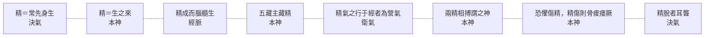

# 69 精：八層

系列第六張（神 8、氣 4、脈 3、血 7、虛實 7、形 8）。方法見 `docs/65`。
**引號規矩同前**：「」只給《靈樞》原文，經機器驗證；『』給其他典籍與我自撰的詞。

---

## 一、八層

| 語境 | 原文 | 出處 |
|---|---|---|
| **生成之源** | 兩神相搏，合而成形，常先身生，是謂精 | 決氣 |
| **生命來處** | 生之來謂之精 | 本神 |
| **成體之始** | 人始生，先成精，精成而腦髓生 | 經脈 |
| **五藏所藏** | 五藏主藏精者也，不可傷，傷則失守而陰虛 | 本神 |
| **化而為氣** | 其精氣之行于經者為營氣 | 衛氣 |
| **生神之材** | 兩精相搏謂之神 | 本神 |
| **耗傷** | 恐懼而不解則傷精；精傷則骨痠痿厥，精時自下 | 本神 |
| **匱乏** | 精脫者耳聾 | 決氣 |

圖檔：`export/多層_精.png`（1400×1100）；HTML：`export/多層_精.html`。



---

## 二、精站在「先天」與「後天」的交界

這是精與其他概念最大的不同。

- **常先身生**（決氣）——它在身體之前。
- **五藏主藏精**（本神）——它又藏在身體之內。

同一部書，同一個字，一邊說「先於身」，一邊說「藏於身」。

**我的理解是**：這不是矛盾，是**兩種時間**。精作為「來源」在身之前；精作為「存量」在身之內。前者不可操作，後者可耗可養。

這也解釋了為什麼靈樞講「保精」「傷精」時，講的都是後者。

---

## 三、一條完整的退化鏈

〈本神〉有一段連鎖，值得單獨看：

> 恐懼而不解則傷精，**精傷則骨痠痿厥，精時自下**。是故五藏主藏精者也，不可傷，**傷則失守而陰虛，陰虛則無氣，無氣則死矣**。

拆開是：

```
恐懼不解 → 傷精 → 骨痠痿厥、精時自下
              ↓
           五藏失守 → 陰虛 → 無氣 → 死
```

**我的理解是**：這是全書少見的一條**從情志到死亡的完整路徑**，而且每一環都有具體名稱。

注意它的樞紐是「失守」——五藏藏精，傷則失守；失守則陰虛；陰虛則無氣；無氣則死。

**「死」不是突然發生的，是最後一環。**

---

## 四、精的兩個去處

圖上可以看到，精有兩條主要出路：

| 去向 | 原文 | 出處 |
|---|---|---|
| **成形** | 精成而腦髓生；骨爲榦，脉爲營…… | 經脈 |
| **化氣** | 其精氣之行于經者為營氣 | 衛氣 |
| **生神** | 兩精相搏謂之神 | 本神 |

**我的理解是**：精不是終點，是**源頭**。它往上生成形體，往內化成營氣，往前生出神。

三個方向，三種產物——這也解釋了為什麼「精」在靈樞裡總帶著「源」的意味。

---

## 五、一個容易被忽略的用法

第五層「其精氣之行于經者為營氣」，出自〈衛氣〉：

> 其浮氣之不循經者為衛氣，**其精氣之行于經者為營氣**。

**我的理解是**：這裡的「精氣」不是「精＋氣」，而是**精華之氣**——與「浮氣」對舉。

同一個「精」字，在這一層是**形容詞**（精華的），不是名詞（精液）。

這正是多層圖要處理的問題：**詞形相同，詞性不同。**

---

## 六、限制

1. **〔我的理解是〕全部是歸納。** 原文沒有「八層」「交界」這些說法。
2. **「精氣」的詞性判斷有爭議。** 我讀作形容詞，也可以讀作複合名詞。
3. **精與髓、精與腦的關係未展開**（經脈只說「精成而腦髓生」）。
4. **未處理「精」與「神」在〈本神〉生成鏈中的先後**（`docs/57` 已論神，此處只取精的角度）。
5. **未用注家。**

---

*資料：`data/多層_精.json`；圖：`export/多層_精.png`*
*前篇：`docs/65`（方法）、`docs/52`（精氣）、`docs/57`（神）*
