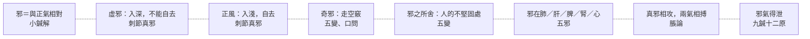

# 71 邪：八層

系列第八張（神 8、氣 4、脈 3、血 7、虛實 7、形 8、精 8、津液 8）。方法見 `docs/65`。
**引號規矩同前**：「」只給《靈樞》原文，經機器驗證；『』給其他典籍與我自撰的詞。

---

## 一、八層

| 語境 | 原文 | 出處 |
|---|---|---|
| **與正相對** | 神者，正氣也；客者，邪氣也 | 小鍼解 |
| **虛邪** | 虛風之賊傷人也，其中人也深，不能自去 | 刺節真邪 |
| **正風** | 正風者，其中人也淺，合而自去，其氣來柔弱，不能勝真氣，故自去 | 刺節真邪 |
| **奇邪** | 奇邪淫溢，不可勝數 | 五變 |
| **所舍** | 骨節皮膚腠理之不堅固者，邪之所舍也 | 五變 |
| **在藏** | 邪在肺，則病皮膚痛，寒熱，上氣 | 五邪 |
| **相攻** | 真邪相攻，兩氣相搏，乃合為脹也 | 脹論 |
| **去路** | 排陽得鍼，邪氣得泄 | 九鍼十二原 |

圖檔：`export/多層_邪.png`（1400×1100）；HTML：`export/多層_邪.html`。

---

## 二、最要緊的一層：虛風與正風

第二、三層是這一組裡最有意思的對比。

同為「風」，〈刺節真邪〉分了兩種：

| | 虛風 | 正風 |
|---|---|---|
| 傷人深淺 | 深 | 淺 |
| 能否自去 | **不能自去** | **合而自去** |
| 原因 | 賊 | 其氣柔弱，不能勝真氣 |
| 名字 | 虛邪 | 正風 |

**白話**：虛風傷人深，不會自己走；正風傷人淺，自己就散了，因為它的氣柔弱，打不過真氣。

**我的理解是**：這一句把「邪」的定義講清楚了——**邪不是所有的風，是不正的那一種**。

正風也是風，也吹到人身上，但它「不能勝真氣」，所以不成邪。**邪的成立，取決於它能不能勝過正氣。**

這與 `docs/59` 的「兩虛相得」是同一個思路：不是外來者壞，是力量對比決定了它成不成為邪。

---

## 三、邪之所舍：不是邪選人，是人的不堅固處招邪

〈五變〉：

> 人之有常病也，亦因其**骨節皮膚腠理之不堅固者，邪之所舍也**，故常為病也。

**白話**：人有固定會得的病，也是因為骨節、皮膚、腠理不堅固的地方，正是邪停留的地方，所以常常生病。

**我的理解是**：這一句把病因與體質接起來了（`docs/60`）。

它不說『邪侵犯了哪裡』，而說**邪停在不堅固的地方**。主語其實是人，不是邪。

---

## 四、邪的兩個極端

圖的兩端分別是『與正相對』與「得泄」：

- **一端是關係**：邪只是正氣的對立面，不是獨立實體。
- **另一端是結果**：刺對了，邪氣可以被瀉出去。

**我的理解是**：靈樞的邪，從頭到尾都不是一個「東西」。它是一組關係（與正氣相對）、一種性質（虛）、一個位置（所舍）、一個過程（相攻），最後是一個可以被排除的對象。

---

## 五、限制

1. **〔我的理解是〕全部是歸納。** 原文沒有「八層」『關係而非實體』這些說法。
2. **「虛邪」與「正風」的對比，我只用了〈刺節真邪〉**；〈邪氣藏府病形〉另有一組『虛邪／正邪』的對比，措辭略異，未並列。
3. **五邪篇的五藏之邪，我只列了肺一條**，其餘四藏未展開。
4. **邪與「病」的關係，本文只點到**，未展開。
5. **未用注家。**

---

*資料：`data/多層_邪.json`；圖：`export/多層_邪.png`*
*前篇：`docs/59`（病因）、`docs/60`（體質）、`docs/65`（方法）*
