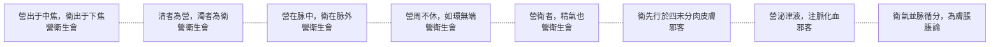

# 72 營衛：八層

系列第九張，也是最後一組大概念（神 8、氣 4、脈 3、血 7、虛實 7、形 8、精 8、津液 8、邪 8）。方法見 `docs/65`。
**引號規矩同前**：「」只給《靈樞》原文，經機器驗證；『』給其他典籍與我自撰的詞。

---

## 一、八層

| 語境 | 原文 | 出處 |
|---|---|---|
| **出處** | 營出于中焦，衛出于下焦 | 營衛生會 |
| **清濁** | 其清者為營，濁者為衛 | 營衛生會 |
| **內外** | 營在脉中，衛在脉外 | 營衛生會 |
| **循環** | 營周不休，五十而復大會，陰陽相貫，如環無端 | 營衛生會 |
| **身分** | 營衛者，精氣也 | 營衛生會 |
| **衛之行** | 先行於四末分肉皮膚之間而不休者也 | 邪客 |
| **營之化** | 營氣者，泌其津液，注之於脉，化以為血 | 邪客 |
| **失常** | 衛氣並脉循分，為膚脹 | 脹論 |

圖檔：`export/多層_營衛.png`（1400×1100）；HTML：`export/多層_營衛.html`。

---

## 二、營衛不是兩種氣

第五層是這一組的關鍵：

> **營衛者，精氣也。**

**我的理解是**：營與衛不是兩種不同的物質，而是**同一份精氣的兩種運行方式**。

證據在另外三層：

- **清濁**：同一批水穀，清者為營、濁者為衛——分的是**品質**，不是來源。
- **內外**：同一條脈，營在裡面、衛在外面——分的是**位置**。
- **出處**：營出中焦、衛出下焦——分的是**起點**。

三者合起來，才是一套完整的區分。單看任何一層，都會誤以為是『兩種東西』。

---

## 三、衛氣的位置，比「脈外」更遠

第三層說「衛在脉外」，但第六層說得更遠：

> 先行於四末分肉皮膚之間而不休者也。

**我的理解是**：衛氣不只是「在脈外」，它跑到**四肢末端、分肉、皮膚**——身體的最外圍。

這也解釋了為什麼〈邪客〉說衛氣「先行」：它是**最先到達表面**的那一層。

而營氣相反：泌津液、注脈、化血，全在內層進行。

**一個往外跑，一個往內化。**

---

## 四、失常：衛氣走錯路

第八層是這一組裡唯一的病理層：

> 衛氣並脉循分，為膚脹。

**白話**：衛氣併著脈、沿著分肉走，就成了膚脹。

對照〈脹論〉前文：

> 營氣循脉，衛氣逆，為脉脹；衛氣並脉循分，為膚脹。

**我的理解是**：同一種病（脹），差別在**衛氣走哪條路**——逆著走成脈脹，併著脈走成膚脹。

這又是『位置決定病名』（`docs/56`）。

---

## 五、這一組的特別之處

前面八組概念，多半是『一個字多層意思』。營衛不同：**它是兩個字，但常常不能分開講。**

- 「營衛者，精氣也」——合稱時是一件事。
- 「營在脉中，衛在脉外」——分開時是兩件事。

**我的理解是**：營衛的層次，不在『同一個字的多義』，而在**「合與分」兩種看法**。

合起來看，它是精氣；分開來看，它是清濁、內外、出處、行法的差異。兩者都對，取決於你問的是什麼。

---

## 六、限制

1. **〔我的理解是〕全部是歸納。** 原文沒有「合與分」這種說法。
2. **「衛出于下焦」與後世『衛出上焦』之說不同**，本文只錄原文，不比較。
3. **衛氣與睡眠的關係**（行於陽則寤、行於陰則寐）未列入，可另作一層。
4. **營衛與五十營的關係**（營周不休、五十而復大會）只點到，未展開。
5. **未用注家。**

---

*資料：`data/多層_營衛.json`；圖：`export/多層_營衛.png`*
*前篇：`docs/49`（營衛）、`docs/52`（宗氣）、`docs/58`（時間）、`docs/65`（方法）*
