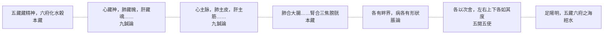

# 73 藏府：七套對應

系列第十張。方法見 `docs/65`。
**引號規矩同前**：「」只給《靈樞》原文，經機器驗證；『』給其他典籍與我自撰的詞。

---

## 一、七套對應

| 語境 | 原文 | 出處 |
|---|---|---|
| **職能** | 五藏者，所以藏精神血氣魂魄者也；六府者，所以化水穀而行津液者也 | 本藏 |
| **所藏** | 心藏神，肺藏魄，肝藏魂，脾藏意，腎藏精志 | 九鍼論 |
| **所主** | 心主脉，肺主皮，肝主筋，脾主肌，腎主骨 | 九鍼論 |
| **相合** | 肺合大腸……腎合三焦膀胱，三焦膀胱者，腠理毫毛其應 | 本藏 |
| **畔界** | 五藏六府者，各有畔界，其病各有形狀 | 脹論 |
| **次舍** | 府藏之在中也，各以次舍，左右上下，各如其度也 | 五閱五使 |
| **海** | 足陽明，五藏六府之海也 | 經水 |

圖檔：`export/多層_藏府.png`（1400×1050）；HTML：`export/多層_藏府.html`。

---

## 二、這一張與前面九張不同

前面九張處理的是『同一個字，多層意思』——神、氣、脈、血……都只有一個字，卻在不同語境裡指不同的東西。

藏府不一樣：**字沒有多義，多的是「對應表」。**

同一組五藏六府，被反覆放進七張不同的網：

| 網 | 回答什麼問題 |
|---|---|
| 職能 | 它做什麼？ |
| 所藏 | 它藏什麼？ |
| 所主 | 它管哪個身體部位？ |
| 相合 | 它和誰表裡配對？ |
| 畔界 | 它的邊界在哪？ |
| 次舍 | 它在體內的哪個位置？ |
| 海 | 哪一處是它们的匯聚？ |

**我的理解是**：這不是一義多層，是**一組對象的多重關係**。用「多層」的畫法仍然有效，因為每一層都是獨立的、不能互相取代的。

---

## 三、最容易混的兩張：所藏與相合

- **所藏**（九鍼論）：心藏神，肺藏魄，肝藏魂，脾藏意，腎藏精志——把**神志**分給五藏。
- **相合**（本藏）：肺合大腸、心合小腸、肝合膽、脾合胃、腎合三焦膀胱——把**表裡配偶**分給五藏。

兩張網的軸完全不同：一個講『這個藏裡住著什麼』，一個講『這個藏跟哪個府配對』。

**我的理解是**：把它們混用，就會得出『肝藏魂，所以肝與膽相合是因為魂』這種原文沒有的推論。

---

## 四、畔界與次舍：位置決定病名

第五、六層都關乎位置：

> 五藏六府者，**各有畔界**，其病**各有形狀**。（〈脹論〉）
>
> 府藏之在中也，**各以次舍**，左右上下，各如其度也。（〈五閱五使〉）

**我的理解是**：靈樞講藏府，不只講功能，也講**邊界與次序**。

有邊界，病才有位置；有次序，診才有對應。這與 `docs/56` 的『位置決定病名』是同一套思路。

---

## 五、藏府的統一線

七張網裡，只有一張是「總綱」性質的：

> 五藏者，所以藏精神血氣魂魄者也；六府者，所以化水穀而行津液者也。

**我的理解是**：靈樞區分藏與府，靠的是**動詞**——藏是「藏」，府是『化、行、受』。

不是位置（都在腹中），不是形態（實心或中空），是功能動詞。

（此點在 `docs/49` 已論，此處只作圖上的第一層。）

---

## 六、限制

1. **〔我的理解是〕全部是歸納。** 原文沒有『七套對應』這種說法。
2. **「七套」是我挑的，可能還有第八、第九套**（例如五色、五音、五味與藏府的對應）。
3. **藏府與經脈的對應未列入**（十二經屬藏府，那是另一張網）。
4. **本圖的「字」是「藏府」兩字合稱**，與前面單字不同；圖上以「藏府」並列，是為了配合模板。
5. **未用注家。**

---

*資料：`data/多層_藏府.json`；圖：`export/多層_藏府.png`*
*前篇：`docs/49`（藏府）、`docs/53`（皮肉筋脈骨）、`docs/65`（方法）*
