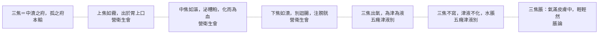

# 74 三焦：七層

系列第十一張，也是最後一張。方法見 `docs/65`。
**引號規矩同前**：「」只給《靈樞》原文，經機器驗證；『』給其他典籍與我自撰的詞。

---

## 一、七層

| 語境 | 原文 | 出處 |
|---|---|---|
| **總名** | 三焦者，中瀆之府也，水道出焉，屬膀胱，是孤之府也 | 本輸 |
| **上焦** | 上焦出于胃上口，並咽以上，貫膈而布胸中；上焦如霧 | 營衛生會 |
| **中焦** | 中焦亦並胃中，出上焦之後，此所受氣者，泌糟粕，蒸津液，化其精微，上注于肺脉，乃化而爲血；中焦如漚 | 營衛生會 |
| **下焦** | 下焦者，別迴腸，注于膀胱而渗入焉；下焦如瀆 | 營衛生會 |
| **出氣** | 三焦出氣，以温肌肉，充皮膚，為其津 | 五癃津液別 |
| **不寫** | 三焦不寫，津液不化……水溢則爲水脹 | 五癃津液別 |
| **脹** | 三焦脹者，氣滿于皮膚中，輕輕然而不堅 | 脹論 |

圖檔：`export/多層_三焦.png`（1400×1050）；HTML：`export/多層_三焦.html`。

---

## 二、靈樞自己承認它特殊

第一層就是關鍵：

> 三焦者，中瀆之府也，水道出焉，屬膀胱，**是孤之府也**。

「孤」這個字，在六府裡只給了三焦。

六府兩兩相合：膽與肝、胃與脾、大腸與肺、小腸與心、膀胱與腎。**只有三焦找不到配偶。**

**我的理解是**：這是靈樞自己留下的一個空白。它沒有替三焦補一個配偶，也沒有解釋為什麼。

---

## 三、三段的描述，全是「做什麼」

上、中、下三焦，原文沒有一句講它們的形體，全靠動詞：

| 段 | 從哪裡 | 做什麼 | 比喻 |
|---|---|---|---|
| 上焦 | 出于胃上口 | 貫膈、布胸中、走腋 | **如霧** |
| 中焦 | 並胃中 | 泌糟粕、蒸津液、化精微、上注肺脉、化而為血 | **如漚** |
| 下焦 | 別迴腸 | 注膀胱、滲入 | **如瀆** |

**我的理解是**：霧、漚、瀆三個字，是狀態而不是器官。

- 霧：瀰漫
- 漚：浸泡、發酵
- 瀆：溝渠

三段合起來，是一條從「氣化」到「泌別」到「排出」的流程。**三焦的內容，就是這條流程本身。**

---

## 四、三焦的兩個病

第六、七層是三焦自己的病：

**其一，不寫**：

> 三焦不寫，津液不化。
>
> 水穀幷行腸胃之中，別于迴腸，留于下焦，不得渗膀胱，則下焦脹，水溢則爲水脹。

**白話**：三焦不瀉，津液不能化，水溢出來就成水脹。

**其二，脹**：

> 三焦脹者，氣滿于皮膚中，輕輕然而不堅。

**白話**：三焦脹，氣充滿在皮膚中，輕輕的，按下去不堅實。

**我的理解是**：這兩個病都指向同一件事——**三焦的病是『通道的病』**。不寫是通道堵了，脹是通道裡的氣滿到皮膚。都不是『某個器官壞了』。

---

## 五、為什麼三焦最適合用多層圖

前面十個概念，多層是因為『同一個字在不同語境指不同東西』。

三焦不同：**它只有一個東西，但這個東西本身沒有形體，只能靠功能與位置來描述。**

| 概念 | 多層的原因 |
|---|---|
| 神、氣、血…… | 一個字，多種用法 |
| **三焦** | **一個實體，只有功能，沒有形體** |

**我的理解是**：所以三焦的圖不是「多義」，而是「多面」——同一個空心的東西，從七個角度照過去，每一面都是真的，合起來仍然沒有一個形體。

這也解釋了為什麼後世對三焦爭論不休：**原文給的是一組功能，不是一個器官。** 要把它當器官找，永遠找不到。

---

## 六、限制

1. **〔我的理解是〕全部是歸納。** 原文沒有說三焦『沒有形體』——它只說「是孤之府」。
2. **本文不裁決三焦的本體問題。** 『三焦是什麼』是中醫史上最大的爭論之一，此處只呈現靈樞怎麼用它。
3. **三焦與心包的配對（後世說）未列入**，因為靈樞說它是「孤之府」。
4. **三焦與衛氣的關係**（衛出于下焦）只點到，未展開。
5. **未用注家。**

---

*資料：`data/多層_三焦.json`；圖：`export/多層_三焦.png`*
*前篇：`docs/49`（三焦）、`docs/52`（四海）、`docs/70`（津液）、`docs/65`（方法）*
