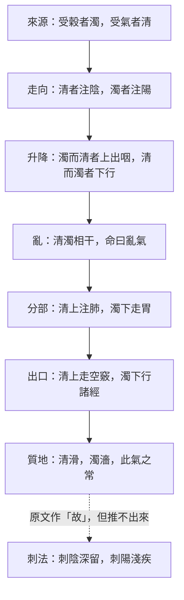

# 77 清濁：八層，與一個接不上的「故」

系列第十二張，補 `docs/76` 指出的缺口。方法見 `docs/65`。
**引號規矩同前**：「」只給《靈樞》原文，經機器驗證；『』給其他典籍與我自撰的詞。

---

## 一、八層

| 語境 | 原文 | 出處 |
|---|---|---|
| **來源** | 受穀者濁，受氣者清 | 陰陽清濁 |
| **走向** | 清者注陰，濁者注陽 | 陰陽清濁 |
| **升降** | 濁而清者上出于咽，清而濁者則下行 | 陰陽清濁 |
| **亂** | 清濁相干，命曰亂氣 | 陰陽清濁 |
| **分部** | 氣之大別，清者上注于肺，濁者下走于胃 | 陰陽清濁 |
| **出口** | 其清者上走空竅，其濁者下行諸經 | 陰陽清濁 |
| **質地** | 清者其氣滑，濁者其氣濇，此氣之常也 | 陰陽清濁 |
| **刺法** | 刺陰者深而留之，刺陽者淺而疾之 | 陰陽清濁 |

圖檔：`export/多層_清濁.png`（1400×1120）；HTML：`export/多層_清濁.html`。

---

## 二、前六層是自洽的

清：注陰 → 上出咽 → 上注肺 → 上走空竅。
濁：注陽 → 下行 → 下走胃 → 下行諸經。

一條升、一條降，兩條在中途會交叉，交叉就叫亂氣。**六層之間沒有打架。**

「分部」一層還藏了兩個例外，原文自己點出來：

> 諸陽皆濁，何陽濁甚乎？岐伯曰：手太陽獨受陽之濁，手太陰獨受陰之清。

> 諸陰皆清，足太陰獨受其濁。

六陽都濁，但小腸最濁；六陰都清，但脾獨受濁。有通則、有極端值，這是靈樞慣用的寫法。

還有一點值得記住：**清濁的來源不是陰陽，是「穀」與「氣」。** 開頭就說「受穀者濁，受氣者清」，所以它從第一天起就是後天氣（水穀）的二分，不是天地宇宙論的二分。這一點在第五節會回來咬人。

〔歸〕我的歸納：清濁不是兩種氣，是同一股氣的兩種質地；六層講的是這股氣『從哪裡來、往哪裡去、亂了叫什麼、從哪裡出去』。

---

## 三、第七層：唯一可以拿去別篇用的通則

> 清者其氣滑，濁者其氣濇，此氣之常也。

這是全篇唯一的「性質」陳述。前六層都在講路徑，只有這一句講**摸起來怎樣**，所以它也是唯一被別篇借去用的。

| 篇 | 用法 | 原文 |
|---|---|---|
| 逆順肥瘦 | 換成體質軸判斷刺法 | 此人重則氣濇血濁，刺此者深而留之，多益其數；勁則氣滑血清，刺此者淺而疾之 |
| 逆順肥瘦 | 當作寫法的警戒線 | 血清氣濁，疾寫之則氣竭焉 |
| 血絡論 | 解釋針下現象 | 血氣俱盛而陰氣多者，其血滑，刺之則射；陽氣畜積久留而不寫者，其血黒以濁，故不能射 |
| 決氣 | 當作診斷變量 | 血脈之清濁，何以知之 |
| 衛氣失常 | 當作調治前提 | 必先別其三形，血之多少，氣之清濁，而後調之 |

〔歸〕『清滑濁濇』是《靈樞》裡少見的、可以直接當操作參數的性質描述。它比「清濁」這個名目有用得多——名目只在這一篇，性質卻在五篇裡幹活。

---

## 四、第八層：那個「故」接不上

原文是：

> 清者其氣滑，濁者其氣濇，此氣之常也。**故**刺陰者深而留之，刺陽者淺而疾之。

「故」是推論詞。可是照本篇自己的設定推：

1. 清＝陰（清者注陰）；
2. 清＝滑（清者其氣滑）；
3. 所以陰＝滑；
4. 滑該淺刺疾出——原文卻說刺陰**深而留之**。

**推不通。**

這不是我一個人的問題。三個本子、兩位注家，正好停在這裡，各用各的辦法補：

| 版本／注家 | 讀法 | 怎麼處理 |
|---|---|---|
| 靈樞底本、甲乙經、類經經文 | 刺陰深留、刺陽淺疾 | 保留原文 |
| 太素 | **刺陽**深留、**刺陰**淺疾 | 兩句對調。蕭延平校語：『靈樞刺陽作刺陰，刺陰作刺陽，甲乙同』 |
| 楊上善 | 清滑者刺淺疾，濁澀者刺深留 | 用清濁改寫規則，並點明本篇標籤與他書相反（見第五節） |
| 張介賓 | 陰者在裏故深留，陽者在表故淺疾 | 不從清濁推，把「陰陽」解成裏表 |

四種處理，其實都在承認同一件事：**這個「故」不是邏輯推論。** 張介賓最典型——他為了保住原文，把『刺陰』的陰從『清濁之陰』換成『裏表之陰』。這是注家在替原文補縫，而且他自己也知道在補，所以特地寫『此又以鍼下之氣言清濁陰陽也』。

〔歸〕我的讀法：這句是全書的通則，不是本篇的推論。〈終始〉有同樣的規則，理由卻完全不同——

> 病痛者，陰也，痛而以手按之不得者，陰也，深刺之。病在上者，陽也；病在下者，陰也。癢者，陽也，淺刺之。

〈終始〉的陰陽指病位（痛、按之不得者在陰），不是清濁。所以『深留／淺疾』講的是**裏外深淺**，跟清滑濁濇是兩套座標。作者把它放在「此氣之常也」後面，是因為講完「清濁相干」總要有個處置框架，不是因為它從滑濇推得出來。

**但我不判底本錯。** 底本與甲乙、類經經文三者一致，太素是孤證；而且張介賓的裏表讀法能自圓其說。列為 `C13`，未解。

---

## 五、標籤衝突：清到底是陰還是陽

同一部書裡，清／濁貼的陰陽標籤不一樣：

| 出處 | 說法 | 清屬於 |
|---|---|---|
| 陰陽清濁 | 清者注陰，濁者注陽 | 陰 |
| 營衛生會 | 其清者為營，濁者為衛 | 陰（營） |
| 五亂 | 清氣在陰，濁氣在陽 | 陰 |
| 素問·陰陽應象大論 | 『清陽為天，濁陰為地』『清陽出上竅，濁陰出下竅』 | 陽 |

靈樞按**營衛**分陰陽（營在脈內為陰），素問按**天地**分陰陽（天為陽）。標籤相反，方向卻一致：清上升、濁下降，兩邊都同意。

楊上善一千四百年前就注意到這件事，寫在注裡：

『諸經多以清者為陽、濁者為陰，此經皆以谷之悍氣為濁為陽、谷之精氣為清為陰，有此不同也。』

〔歸〕這句注的價值在於：它把「清＝陰」判為**本篇的特別約定**，而不是通例。所以清濁與陰陽不能當成可互換的等式；能互換的只有方向（上／下）。誰把兩套標籤混用，就會得到第四節那種推不通的句子。

---

## 六、跨篇接點：清濁派什麼用

| 篇 | 清濁的角色 | 做法 |
|---|---|---|
| 營衛生會 | 命名 | 清者為營，濁者為衛 |
| 五亂 | 病機 | 清氣在陰，濁氣在陽……清濁相于，亂于胸中，是謂大悗 |
| 五亂 | 順逆判準 | 清濁不相于，如是則順之而治 |
| 九鍼十二原 | 病位三層 | 邪氣在上，濁氣在中，清氣在下 |
| 小鍼解 | 解釋病位 | 清氣在下者，言清濕地氣之中人也，必從足始 |
| 逆順肥瘦 | 刺法（體質軸） | 此言氣之滑澀，血之清濁，行之逆順也 |
| 血絡論 | 現象解釋 | 其血黒以濁，故不能射 |
| 決氣 | 診斷 | 血脈之清濁，何以知之 |
| 衛氣失常 | 調治前提 | 必先別其三形，血之多少，氣之清濁，而後調之 |

但要看密度：

- 「清濁」二字連用：**7 篇**，其中 5 次在〈陰陽清濁〉；
- 「清」「濁」單字：**25 篇、102 字次**，〈陰陽清濁〉佔 38 次（37%）。

〔歸〕所以清濁是『**一個篇的概念＋多篇的接點**』。核心高度集中，接點散在五、六篇。

這對 `docs/75` 的規律三（概念跨篇分佈）是個**弱反例**：先前幾張圖（血、精、津液、營衛）都是核心散在多篇，清濁卻幾乎住在一篇裡。規律三要補一句限定：『多數概念跨篇，但少數概念由單篇定義、別篇引用』。

---

## 七、空白（逐項標）

| 空白 | 判定 | 檢索方式 |
|---|---|---|
| 沒有定義 | 〔空〕全書無『何謂清濁』式定義 | 『何謂清濁』『清濁者』『所謂清濁』三式，0 命中 |
| 不能轉化 | 〔空〕沒說清能否變濁 | 通檢語氣詞，未見『清化為濁』一類表述 |
| 沒有量 | 〔空〕沒有清濁多少的數值 | 對照〈決氣〉六氣、〈經水〉十二水皆有數，此篇無 |
| 「以數調之」的數沒給 | 〔空〕只說以數調，未言何數 | 張介賓補作『察其孰微孰甚而酌其數』，是注不是經 |
| 清濁與虛實的關係 | 〔空〕兩者未對接 | 全書虛實自成一系，未與清濁並論 |

這五條都是『原文沒有』，所以標〔空〕。**其中『沒有定義』尤其要小心**：清濁用了 102 次，是全書高頻詞，卻和氣、脈、邪一樣沒有定義式——這正是 `docs/49` 說的定義密度律（越常用的詞越不解釋自己）。

---

## 八、本次新增與修正

1. **新增 C13**（`data/矛盾清單.csv`）：〈陰陽清濁〉刺法句「故」接不上，太素倒文、楊上善改讀、張介賓改解，三種補法並存，未解。
2. **新增 K17**（`docs/33`）：底本「清濁相干」一見、「清濁相于」一見，〈五亂〉二見皆作「相于」；太素一律作「相干」。干、于形近，底本自相不一，當以「干」為正。
3. **新增 K18**（`docs/33`）：刺法句陰陽二字，太素與靈樞、甲乙相反；三源不一致，不改正文。
4. **修正我自己的預設**：動筆前我打算寫『性質直接推出操作，中間沒有斷層』，並已據此寫好圖說。查證後發現推論不成立，已刪除該句，改成現在的第四節。**這是本次最該記下來的一件事：聽起來最順的那條線，往往就是沒有查證的那條。**

---

## 九、一句話

清濁是《靈樞》裡少有的一條清楚的路線：從穀氣分出來，一升一降，亂了有名字。但路線的終點（刺法）不是從起點推出來的，是外掛上去的通則——原文用一個「故」字把它接住，而那個「故」字，三個版本、兩位注家都接得不太穩。

---

## 十、留下來的三件

1. ~~**概念地圖沒有清濁**~~ ✅ 已補：`docs/64` 現為 46 節點、42 連線，清濁、血絡、標本三節點與 C13、C14 都已入圖。
2. **「以數調之」的數，我給不出來。** 原文只給方法名，沒給數。張介賓的補法（察孰微孰甚而酌其數）仍是原則，不是數值。
3. **清濁與虛實的接點沒查。** 濁是否偏實、清是否偏虛？原文沒有明說，我不替它接。
