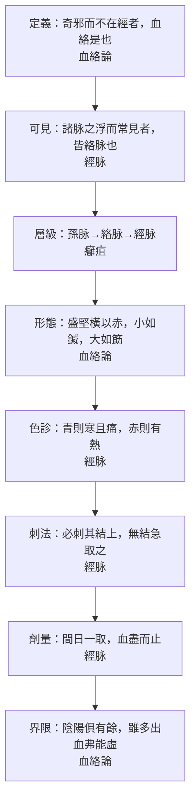

# 78 血絡與絡脈：看得見的那一半

系列第十三張，補 `docs/76` 指出的第二處缺口。方法見 `docs/65`。
**引號規矩同前**：「」只給《靈樞》原文，經機器驗證；『』給其他典籍、注家與我自撰的詞。

---

## 一、這一篇為什麼會被漏掉

〈血絡論〉第三十九，全篇八個「何也」：刺血絡而仆者何也、血出而射者何也、血少黑而濁者何也……問的全是**針刺當下看到的事**。

它不講藏府配屬，不講陰陽大義，沒有一句可以放進概念表。所以整理概念時很容易整篇跳過——`docs/76` 的稽核就是這樣抓到它的：全篇未被任何模組引用。

但它有一個別篇沒有的東西：**全書唯一為「血絡」下的定義。**

---

## 二、唯一的定義，而且是排除式的

> 黃帝曰：願聞其奇邪而不在經者。岐伯曰：血絡是也。

定義式是「……是也」，不是「何謂X」。它給的不是內涵，是**位置**：不在經。

張介賓注：『竒邪即繆刺論所謂竒病也，在絡不在經，行無常處，故曰奇邪。』——他把『奇』解成『行無常處』。

於是「血絡」有兩種讀法：

| 讀法 | 主張 | 支持 |
|---|---|---|
| **狀態說** | 血絡＝有奇邪停留的絡 | 定義句以「奇邪」開頭；先有邪，才有血絡 |
| **結構說** | 血絡＝一類脈管 | 名字像結構；能刺、能出血 |

〔歸〕我偏狀態說，理由是**用法**：全書「血絡」十七見，十五見出現在治法條裡（出、寫、去、取、刺），其餘兩見，一是定義、一是『血絡之所遊』。它幾乎不當主語被描述，只當動作的對象（唯二的例外是定義句與『血絡之所遊』）。而且十五絡個個有專名（『名曰大包』『名曰飛陽』），血絡一個專名都沒有。**沒有名字的「結構」，不像結構。**

---

## 三、三個層級：孫脈—絡脈—經脈

〈癰疽〉給的是灌注次序：

> 血和則孫脉先滿溢，乃注於絡脉；皆盈，乃注於經脉。

血先充滿最細的孫脈，滿了溢到絡脈，再滿才進經脈。

〈百病始生〉的方向相反，是邪氣由外入內：

> 留而不去，則傳舍於絡脉；在絡之時，痛於肌肉，其痛之時息，大經乃代。

皮膚 → 絡脈 → 經脈 → 輸脈 → 伏衝 → 腸胃之外募原 → 成積。

〔歸〕絡是**內外之間的緩衝層**：血從孫絡往裡注，邪從皮膚往裡傳，兩頭都在絡上碰面。這解釋了為什麼刺絡放血有用——它在緩衝層把邪截住，不讓它進經。〈經脉〉那句「留之發為痺也」就是這個邏輯的反面：不刺，邪就留在絡裡成痺。

---

## 四、看得見與看不見（含 K16 的修正）

〈經脉〉給了靈樞最清楚的一條分界：

> 經脉十二者，伏行分肉之間，深而不見。

> 諸脉之浮而常見者，皆絡脉也。

> 經脉者常不可見也，其虛實也以氣口知之；脉之見者，皆絡脉也。

經不可見，絡可見；經的虛實只能從氣口讀，能看見的都是絡。

但原文有一個例外句，而這個例外句讓三個本子、三個注家分成三派：

> 其常見者，足太陰過于外踝之上，無所隱故也。

| 讀法 | 改動 | 長處 | 短處 |
|---|---|---|---|
| 足太陰・外踝（底本） | 無 | 不改字 | 外踝非足太陰所經；與下一句氣口無關 |
| 足太陰・內踝（太素、蕭校） | 外→內 | 改一字，合足太陰循行 | 仍與下一句氣口無關 |
| 手太陰・外踝（張介賓注） | 足→手 | 與下一句「氣口知之」呼應；解釋寸口為何可診 | 「踝」本指足踝，用於手不合常語 |

張注原文：『足太陰當作手太陰……惟手太陰一經過於手外踝之上，因其骨露皮淺故不能隱。下文云「經脉者常不可見也，其虛實也以氣口知之」，正謂此耳。』

**我要在這裡承認一個錯。** `docs/33` 的 K16 原先判「外」是「內」之形訛，依據是太素作內踝、足太陰行內踝前廉。做這一篇時回頭看上下文，才發現張介賓的讀法能接住下一句：氣口就是手太陰寸口，正因為此處經脈藏不住，才能拿它診五藏虛實。

只比字，會得到「內踝」；看下一句，會得到「手太陰」。**校勘不能只看哪個字與他本不同，還要看下一句在講什麼。** K16 已由『當作內』改為『三說並存，未定』。

---

## 五、血絡論的八問八答

這一篇的骨架是八個「何也」，一次問完，再一次答完：

| 問（針下所見） | 答（原文） | 一句話 |
|---|---|---|
| 刺血絡而仆 | 脉氣盛而血虛者，刺之則脫氣，脫氣則仆 | 氣盛血少，放血瀉氣，人會倒 |
| 血出而射 | 血氣俱盛而陰氣多者，其血滑，刺之則射 | 血氣俱旺、陰分液多，血會噴 |
| 血少黑而濁 | 陽氣畜積久留而不寫者，其血黒以濁，故不能射 | 熱邪久積，血稠而黑，噴不出 |
| 血出清而半為汁 | 新飲而液滲于絡，而未合和于血也 | 剛喝過水，水還沒化成血 |
| 發鍼而腫 | 陰氣積于陽，其氣因于絡，故刺之血未出而氣先行，故腫；其不新飲者，身中有水，久則為腫 | 氣先走、血未出，所以腫；或本有水 |
| 色蒼蒼 | 陰陽之氣，其新相得而未和合，因而寫之，則陰陽俱脫，表裏相離 | 氣血剛接上還沒站穩就放血 |
| 色不變而煩悗 | 刺絡而虛經，虛經之屬于陰者，陰脫，故煩悗 | 出血過多，虛到陰經 |
| 多出血而不動搖 | 陰陽相得而合為痺者……陰陽俱有餘，雖多出血而弗能虛也 | 陰陽都有餘，出血傷不到正氣 |

〔歸〕八問其實是同一件事的八個面：**血出來的方式，反映的是氣與血的對比、水與血合沒合、邪積得久不久。** 這一篇教的不是讀脈，是**讀針**——針下看到什麼，反推體內是什麼狀態。

書末還有一問不是血液：「鍼入而肉著者何也」——「熱氣因于鍼則鍼熱，熱則肉著于鍼故堅焉」。講的是針身發熱、肌肉吸針、拔不出來。張介賓注：『肉著者吸著於鍼也，鍼入而熱肉必附之，故𦂳濇難轉而堅不可抜也。』這是操作事故，不是病機，放在同一篇，正說明本篇的性質是技術手冊。

---

## 六、刺法三條、劑量一條

刺法在〈經脉〉，不在〈血絡論〉：

> 故諸刺絡脉者，必刺其結上，甚血者雖無結，急取之，以寫其邪而出其血，留之發為痺也。

- 有結（血聚處）→ 刺結上；
- 血盛而無結 → 也要急取；
- 不取 → 留之發為痺。

劑量也在〈經脉〉：

> 凡刺寒熱者皆多血絡，必間日而一取之，血盡而止，乃調其虛實。

**隔日一取、血盡而止、然後調虛實。** 三句都是規則。

〔歸〕值得注意：〈血絡論〉自己完全沒有劑量，只說「無失數」「失數而反，各如其度」。**同一個技術，原理在一篇、劑量在另一篇**——這是靈樞常見的分記法，也是它難讀的原因之一。

「失數而反，各如其度」有兩種讀法：張介賓讀作『若失其數而反其法，則為仆、為脫、為虛、為腫等證，各如刺度以相應也』，即『失誤的後果按失誤的程度出現』；也可以讀作『若失其數，則反應各如其度』。我取張說，但標存疑。

---

## 七、風險與安全邊界

這一篇最實用的不是『放血的好處』，是**放血的條件**：

| 情況 | 原文 | 後果 |
|---|---|---|
| 脉氣盛而血虛 | 刺之則脫氣，脫氣則仆 | 暈倒 |
| 陰陽新相得未和合 | 因而寫之，則陰陽俱脫，表裏相離 | 面色蒼白 |
| 出血過多，虛及於經 | 刺絡而虛經，虛經之屬于陰者，陰脫 | 煩悗 |
| **陰陽俱有餘** | 雖多出血而弗能虛也 | 安全，出血再多也傷不到正氣 |

〔歸〕判斷條件是**氣血對比**，不是出血量。同樣一針，陰陽俱有餘的人出血多多無妨，脈氣盛而血虛的人一刺就倒。這與 `docs/49`、`docs/67` 講的虛實層次是同一套：虛實不是量，是比例。

---

## 八、十七次『血絡』，十五次在治法條裡

| 篇 | 用法 | 原文 |
|---|---|---|
| 夀夭剛柔 | 久痺 | 視其血絡，盡出其血 |
| 熱病 | 心疝暴痛 | 盡刺去其血絡 |
| 雜病 | 厥頭痛 | 取足太陽膕中血絡 |
| 癲狂 | 補足少陰 | 補足少陰，去血絡也 |
| 水脹 | 膚脹鼓脹 | 先寫其脹之血絡，後調其經，刺去其血絡也 |
| 禁服 | 通則 | 寫其血絡，血盡不殆矣 |
| 四時氣 | 邪在三焦約 | 視其絡脉與厥陰小絡結而血者 |
| 邪客 | 八虛 | 血絡之所遊 |
| 經脉 | 寒熱 | 凡刺寒熱者皆多血絡 |

統計（以底本原文計）：

| 詞 | 次數 | 篇數 |
|---|---:|---:|
| 血絡 | 17 | 13 |
| 絡脈 | 23 | 10（〈經脉〉佔 10） |
| 孫絡 | 4 | 4 |

〔歸〕「血絡」是**分散的操作詞**：本篇只有 2 次（篇名一次、正文兩見），其餘散在十幾篇的治法條裡。它不像「清濁」那樣集中在一個概念篇，也不像「營衛」那樣有系統論述。它是一把工具。

---

## 九、空白（逐項標）

| 空白 | 判定 |
|---|---|
| 血絡沒有專名 | 〔空〕十五絡皆有『名曰X』，血絡無 |
| 沒有粗細、長度、數目 | 〔空〕原文只給「小者如鍼，大者如筯」的目測比擬 |
| 「奇邪」沒有定義 | 〔空〕張介賓引繆刺論補，是注不是經 |
| 沒有出血量單位 | 〔空〕只說「血盡」「血盡而止」 |
| 血絡落在哪一級沒說 | 〔空〕〈癰疽〉給孫→絡→經，但沒說血絡是哪一級 |

最後一條最要緊：〈癰疽〉把層級排好了，〈血絡論〉卻沒說血絡站在哪一級。從「必刺其結上」「小者如鍼，大者如筯」看，它像可觸可視的淺層；從『奇邪不在經』看，它又只是一種狀態。**原文沒有回答。**

---

## 十、圖

圖檔：`export/多層_血絡.png`（1400×1120）；HTML：`export/多層_血絡.html`。

---

## 十一、本次新增與修正

1. **新文件**：本篇 `docs/78`；圖 `export/多層_血絡.png`；資料 `data/多層_血絡.json`。
2. **修正 K16**（`docs/33`、第 10 篇校記）：原判「外→內」，改為三說並存、未定。理由見第四節。
3. **檢查器補兩字**：`scripts/check_quotes.py` 加入 渗／滲、闗／關 異體，否則引文會被誤判為『原文沒有』。
4. **待辦**：
   - `docs/33` 全篇仍有 57 處「」用於自撰詞或他書引文，未依公約改為『』。需逐條判斷，不能批量替換。
   - 標本（〈病本〉25）尚未做——`docs/76` 的第三處缺口。

---

## 十二、一句話

靈樞把『看得見的脈』叫絡、『看不見的脈』叫經，然後用一整篇告訴你：看得見的那一半，要怎麼看、什麼時候可以放血、放錯了會怎樣。它沒有告訴你血絡究竟是什麼——只告訴你它不在哪裡。
