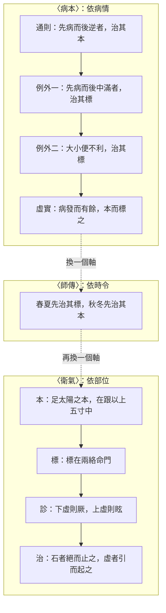

# 79 標本：三個標本

系列第十四張，補 `docs/76` 的第三處缺口。方法見 `docs/65`。
**引號規矩同前**：「」只給《靈樞》原文，經機器驗證；『』給其他典籍、注家與我自撰的詞。

---

## 一、先把字數講清楚

「標本」這兩個字連用，全書只有 **2 次**，都在〈衛氣〉第五十二。

但『治其本／治其標』這類決策句，出現在 **3 篇**：

| 篇 | 「標」字次數 |
|---|---:|
| 病本 25 | 6 |
| 師傳 29 | 2 |
| 衛氣 52 | 14 |

〔歸〕〈病本〉整整一篇講標本，正文一次也沒用「標本」二字。這不是遺漏，是體例：它直接給規則，不給定義。

---

## 二、三個標本，不是同一件事

| 篇 | 本是什麼 | 標是什麼 | 依什麼判斷 |
|---|---|---|---|
| 病本 25 | 先發的病／病因 | 後發的病／現症 | **因果先後** |
| 師傳 29 | 內 | 外 | **時令**（春夏病在外，秋冬病在內） |
| 衛氣 52 | 經脈在四肢的下端 | 經脈在頭面的上端 | **部位上下** |

師傳說得最短：

> 春夏先治其標，後治其本；秋冬先治其本，後治其標。

張介賓注：『春夏之氣達於外，則病亦在外；外者內之標，故先治其標，後治其本。秋冬之氣斂於內，則病亦在內；內者外之本，故先治其本，後治其標。』

〔歸〕三者共用一個方向感——**本在根、標在末**；但『什麼算根』各不相同：病本按因果，師傳按內外，衛氣按上下。這是一個詞被三套座標借用的典型。

---

## 三、病本：十條治本，兩條治標

〈病本〉只有 185 字，是全書最密的決策表。逐條列出：

| # | 病情 | 治 |
|---|---|---|
| 1 | 先病而後逆 | 本 |
| 2 | 先逆而後病 | 本 |
| 3 | 先寒而後生病 | 本 |
| 4 | 先病而後生寒 | 本 |
| 5 | 先熱而後生病 | 本 |
| 6 | 先泄而後生他病 | 本（必且調之，乃治其他病） |
| 7 | 先病而後中滿 | **標** |
| 8 | 先病後泄 | 本 |
| 9 | 先中滿而後煩心 | 本 |
| 10 | 大小便利 | 本 |
| 11 | **大小便不利** | **標** |
| 12 | 先小大便不利而後生他病 | 本 |

**十本、二標。** 張介賓算過同一筆帳：『治本者十之八九，治標者惟中滿及小大不利二者而已。』

兩個例外都有理由，而且理由不同：

- **中滿**：『諸病皆先治本，而惟中滿者先治其標，蓋以中滿為病，其邪在胃；胃者藏府之本也，胃滿則藥食之氣不能行，而藏府皆失其所禀，故先治此者，亦所以治本也。』——治標其實是為了保本。
- **二便不利**：『二便不通乃危急之候，雖為標病必先治之，此所謂急則治其標也。』——急。

〔歸〕所以「治標」在靈樞裡不是一個選項，是兩個**迫不得已**。其餘情況一律治本。這和後世『急則治標、緩則治本』的口訣同構，但靈樞把它收得很窄：只有兩件事算急。

---

## 四、四個原則（不是規則）

規則之外，〈病本〉還給了四句原則：

| 原則 | 原文 |
|---|---|
| 有餘先本 | 病發而有餘，本而標之，先治其本，後治其標 |
| 不足先標 | 病發而不足，標而本之，先治其標，後治其本 |
| 間者並行 | 謹詳察間甚，以意調之；間者并行，甚為獨行 |
| 判斷權 | 以意調之 |

張介賓解「有餘／不足」：『此以病氣强弱而言標本也』——病氣有餘會傳給別人，所以先治本；病氣不足會受別人欺，所以先治標。

「間者并行，甚為獨行」，張注：『病淺者可以兼治，故曰并行；病甚者難容雜亂，故曰獨行。』

〔歸〕「以意調之」四個字值得單獨指出來：前面十一條都是硬規則，這裡忽然交回給醫師。靈樞很常這樣——規則給到某個程度，然後說「以意調之」，不假裝自己算得出來。

---

## 五、靈樞的標本篇，沒有開頭

這一節要跨界，但必須跨，因為不跨就看不到缺口。

〈病本〉從「先病而後逆者，治其本」直接開始。同樣的文字在《素問·標本病傳論》裡，前面還有一大段：

『夫隂陽逆從標本之爲道也，小而大，言一而知百病之害……以淺而知深，察近而知逺，言標與本，易而勿及。治反爲逆，治得爲從。』

『知標本者，萬舉萬當；不知標本是謂妄行。』

**靈樞沒有這一段。** 標本的定義、綱領、『易而勿及』的感嘆，全在素問；靈樞只留下操作手冊。

這正好解釋了第一節的統計：為什麼〈病本〉不用「標本」二字——它把使用說明書丟了，只留按鈕。

**還要指出一處異文（K19）。** 兩書同文而不同：

| 靈樞〈病本〉 | 素問〈標本病傳論〉 |
|---|---|
| （無） | 先熱而後生中滿者，治其標 |
| 先病而後中滿者，治其標 | 先病而後先中滿者，治其標 |
| 先泄而後生他病……／先病後泄 | 先病而後泄……／先泄而後生他病（次第相反） |
| 大小便不利／大小便利 | 小大不利／小大利 |
| 謹詳察間甚 | 謹察間甚 |

素問多一條、靈樞少一條；兩條次序相反；三處字句不同。素問那條多出來的『先熱而後生中滿者治其標』，若算進去，治標就從二條變三條——**『十本二標』這個結論，取決於用哪個本子。**

判存異，不改。靈樞這一篇本來就是節錄，不是全本。

---

## 六、衛氣：十二經的標本表

〈衛氣〉把標本落到具體位置，十二經各一組：

| 經 | 本 | 標 |
|---|---|---|
| 足太陽 | 跟以上五寸中 | 兩絡命門（目） |
| 足少陽 | 竅陰之間 | 窻籠之前（耳） |
| 足陽明 | 厲兌 | 人迎、頰挾頏顙 |
| 足太陰 | 中封前上四寸之中 | 背腧與舌本 |
| 足少陰 | 內踝下上三寸中 | 背腧與舌下兩脈 |
| 足厥陰 | 行間上五寸所 | 背腧 |
| 手太陽 | 外踝之後 | 命門之上一寸 |
| 手少陽 | 小指次指之間上二寸 | 耳後上角下外眥 |
| 手陽明 | 肘骨中上至別陽 | 顏下合鉗上 |
| 手太陰 | 寸口之中 | 腋內動 |
| 手少陰 | 銳骨之端 | 背腧 |
| 手心主 | 掌後兩筋之間二寸中 | 腋下下三寸 |

規律很明顯〔歸〕：**本都在肘膝以下，標都在頭面軀幹。** 所以標本是『四肢—頭面』的縱座標，不是經絡圖上的另一條線。

它接下來就轉成診斷：

> 凡候此者，下虛則厥，下盛則熱；上虛則眩，上盛則熱痛。故石者絕而止之，虛者引而起之。

下＝本（四肢），上＝標（頭面）。四種組合四個結論，然後兩句治法：實則絕而止之，虛則引而起之。

再往下接「氣街」：

> 胷氣有街，腹氣有街，頭氣有街，脛氣有街。

> 氣在頭者，止之于腦。

〔歸〕〈衛氣〉的結構是：標本定位 → 上下虛實 → 氣街取穴。一條線走到底，是靈樞少見的完整操作鏈。

---

## 七、和〈根結〉對不上（C14）

〈根結〉用另一組字講同一件事：根／結。

| 經 | 根結・根 | 衛氣・本 | 根結・結 | 衛氣・標 |
|---|---|---|---|---|
| 足太陽 | 至陰 | 跟以上五寸中 | 命門（目） | 兩絡命門（目） |
| 足少陽 | 竅陰 | 竅陰之間 | 窻籠（耳中） | 窻籠之前 |
| 足陽明 | 厲兌 | 厲兌 | 顙大（鉗耳） | 人迎、頰挾頏顙 |
| 足太陰 | 隱白 | 中封前上四寸 | 大倉 | 背腧與舌本 |
| 足少陰 | 湧泉 | 內踝下上三寸 | 廉泉 | 背腧與舌下兩脈 |
| 足厥陰 | 大敦 | 行間上五寸所 | 玉英 | 背腧 |

兩點：

1. **三陽的根約等於本**（太陽稍異：至陰 vs 跟以上五寸）。
2. **三陰的根與本完全不同**：根在井穴（隱白、湧泉、大敦），本在踝上（中封前上四寸、內踝下上三寸、行間上五寸所）。
3. **結與標**：太陽、少陽大致相同；陽明與三陰不同（根結取廉泉、玉英、大倉，衛氣取背腧）。

〔歸〕這不是誰抄錯。井穴是『經氣所出』，踝上是『脈氣所起』——兩篇取的起點本來就不一樣。但原文沒有交代兩套怎麼並用，所以列為 C14，未解。

順帶一句：〈根結〉自己還有第二套，叫『根溜注入』——

> 足太陽根于至陰，溜于京骨，注于崑崙，入于天柱、飛揚也。

同一篇裡，前半是根／結，後半是根／溜／注／入。**光〈根結〉一篇就有兩套端點系統。**

---

## 八、空白（逐項標）

| 空白 | 判定 |
|---|---|
| 靈樞沒有標本的定義 | 〔空〕定義與綱領在素問〈標本病傳論〉，靈樞〈病本〉自「先病而後逆」起 |
| 「客氣」「同氣」沒解釋 | 〔空〕原文只說「有客氣，有同氣」，下一句直接講二便。張介賓補為運氣（客氣＝流行運氣，同氣＝四時主氣），是注不是經 |
| 三套標本誰優先 | 〔空〕同時碰上（春天＋中滿＋經脈標病）以誰為準，原文沒說 |
| 為什麼本在肘膝以下 | 〔空〕〈衛氣〉只給位置，不給理由 |
| 為什麼陰經的標在背腧 | 〔空〕六陰經有四條標在背腧，原文未釋 |
| 根結與衛氣如何並用 | 〔空〕列 C14 |

〔歸〕最後兩條最要緊。標本看起來像一套完整系統，其實三篇各講各的，中間的接口原文沒有寫。所謂『標本理論』，是我在事後把它們拼起來的——拼得通，但不是原文說的。

---

## 九、圖

圖檔：`export/多層_標本.png`（1400×1180）；HTML：`export/多層_標本.html`。

---

## 十、本次新增與修正

1. **新文件**：本篇 `docs/79`；圖 `export/多層_標本.png`；資料 `data/多層_標本.json`。
2. **新增 C14**（`data/矛盾清單.csv`、`docs/63`）：〈根結〉與〈衛氣〉對十二經端點取法不同，陰經分歧最大，未解。
3. **新增 K19**（`docs/33`、`data/校勘點.csv`）：〈病本〉與素問〈標本病傳論〉同文而多異——素問多一條『先熱而後生中滿』、兩條次序相反、三處字句不同。判存異，不改。
4. **完成 `docs/76` 的三處缺口**：清濁（`docs/77`）、血絡（`docs/78`）、標本（本篇）。

---

## 十一、一句話

標本在靈樞裡不是一個理論，是三個決策習慣：先治因、先治急、先治外。三篇各用一組座標，共用兩個字。而把它們串成體系的那段話，寫在素問裡，靈樞沒有抄。
